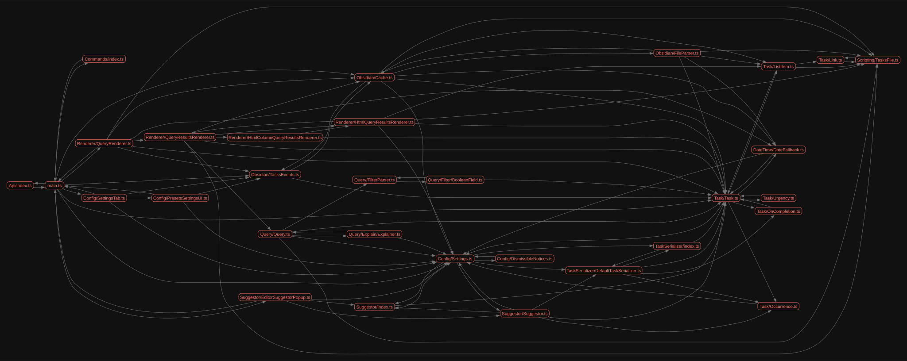

# How do I see circular dependencies

This page assumes that you have already set up your [[Local development]]

## What are circular dependencies?

The article [Tired of circular dependency in Typescript/Node.js?](https://dev.to/tahsinature/tired-of-circular-dependency-in-typescriptnodejs-4i0a) has a good explanation, building on the following quote from [Wikipedia](https://en.wikipedia.org/wiki/Circular_dependency):

> In software engineering, a circular dependency is a relation between two or more modules which either directly or indirectly depend on each other to function properly. Such modules are also known as mutually recursive.

## How to see circular dependencies in Tasks?

### Via GitHub Actions builds

- Browse to the [Verify Commit logs](https://github.com/obsidian-tasks-group/obsidian-tasks/actions/workflows/verify.yml)
  - Choose the branch of interest (at top-right)
  - Click on the most recent run of code on that branch
- Click on the `circular-dependencies` link in the Artifacts list at the bottom of the page to down the results
  - Expand the .zip file
- View the two files:
  - `circular-deps.txt`
  - `circular-deps.png`

### On your local machine

- Install [Graphviz](https://graphviz.org), making sure that the [gvpr](https://graphviz.org/docs/cli/gvpr/) command is available
- Run one of the following commands:

```bash
yarn run circular-deps-text
yarn run circular-deps-image
```

## Automatic checks for circular dependencies

Two GitHub Actions workflows track circular dependencies so that nobody needs to remember to run the commands above.
The workflow source files are in [.github/workflows](https://github.com/obsidian-tasks-group/obsidian-tasks/tree/main/.github/workflows).

### Keeping `circular-deps.txt` up to date

The file [circular-deps.txt](https://github.com/obsidian-tasks-group/obsidian-tasks/blob/main/circular-deps.txt) in the root of the repository lists the current circular dependencies.

- The [update-circular-deps](https://github.com/obsidian-tasks-group/obsidian-tasks/blob/main/.github/workflows/update-circular-deps.yml) workflow runs whenever code is pushed or merged to `main`.
  - It runs `yarn run circular-deps-text`.
  - If `circular-deps.txt` has changed, it creates a pull request to update the file. If nothing has changed, it does nothing.
  - [See the run results](https://github.com/obsidian-tasks-group/obsidian-tasks/actions/workflows/update-circular-deps.yml)
- Contributors do not need to update `circular-deps.txt` in their own pull requests. This avoids merge conflicts.

### Checking whether a pull request adds circular dependencies

- The [circular-deps-check](https://github.com/obsidian-tasks-group/obsidian-tasks/blob/main/.github/workflows/circular-deps-check.yml) workflow runs on every pull request to `main`.
  - It compares the circular dependencies in the pull request, as merged into `main`, with those in the `main` commit it would be merged onto.
  - It fails if the pull request adds any circular dependencies.
  - Click `Details` next to the failed check, and open the `Fail if the pull request adds circular dependencies` step, to see which circular dependencies were added and removed.
  - [See the run results](https://github.com/obsidian-tasks-group/obsidian-tasks/actions/workflows/circular-deps-check.yml)
- A failure does not block merging. The maintainers decide whether a new circular dependency is acceptable.
- Renaming or moving a file that is part of a circular dependency is reported as one removed and one added, and so will also fail.
- To run the same comparison on your local machine, use the following command. The optional argument is any git ref to compare against, and it defaults to `origin/main`:

    ```bash
    node scripts/circular-deps-compare.mjs
    ```

The comparison is done by [circular-deps-compare.mjs](https://github.com/obsidian-tasks-group/obsidian-tasks/blob/main/scripts/circular-deps-compare.mjs), which has comments explaining how it works.

## Example output files

`circular-deps.txt`:

```text
Current circular dependencies:

Config/Settings.ts > Config/DismissibleNotices.ts
Config/Settings.ts > Suggestor/Suggestor.ts
Config/Settings.ts > Suggestor/Suggestor.ts > Suggestor/index.ts
Config/Settings.ts > Suggestor/Suggestor.ts > Suggestor/index.ts > Task/Task.ts
Config/Settings.ts > Suggestor/Suggestor.ts > Suggestor/index.ts > Task/Task.ts > DateTime/DateFallback.ts
Task/Task.ts > DateTime/DateFallback.ts
Scripting/TasksFile.ts > Task/Link.ts
Task/Task.ts > Task/ListItem.ts
Config/Settings.ts > Suggestor/Suggestor.ts > Suggestor/index.ts > Task/Task.ts > Task/Occurrence.ts
Task/Task.ts > Task/OnCompletion.ts
Task/Task.ts > Task/Urgency.ts
TaskSerializer/DefaultTaskSerializer.ts > TaskSerializer/index.ts
Api/index.ts > main.ts
Query/FilterParser.ts > Query/Filter/BooleanField.ts
Query/Query.ts > Query/Explain/Explainer.ts
main.ts > Commands/index.ts
Obsidian/Cache.ts > Obsidian/FileParser.ts
Obsidian/TasksEvents.ts > Obsidian/Cache.ts
main.ts > Config/SettingsTab.ts > Config/PresetsSettingsUI.ts
main.ts > Config/SettingsTab.ts
Renderer/QueryResultsRenderer.ts > Renderer/HtmlColumnQueryResultsRenderer.ts > Renderer/HtmlQueryResultsRenderer.ts
main.ts > Renderer/QueryRenderer.ts
main.ts > Suggestor/EditorSuggestorPopup.ts
```

`circular-deps.png`:

%%Note on a slight cheat: an SVG is shown here, as it gives better scaling when published.
But the appearance is the same as the generated PNG %%


