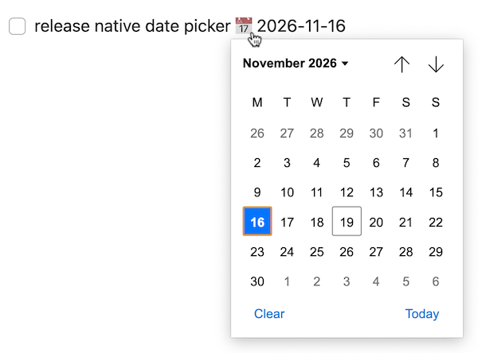
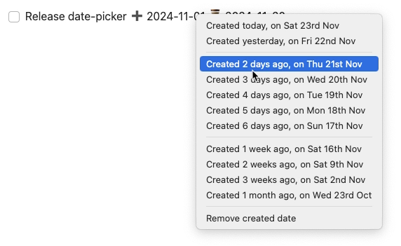

# Editing Dates

#feature/dates

## Summary

Tasks supports a range of date properties for managing your tasks: see [[Dates]].

This page describes ways to add, edit and remove date values on tasks.

There is a [[#Date-picker on task dates]] and a [[#Context menu on task dates]], and there are [[#Change, Add, Move and Remove date commands|commands]] to edit dates on one or more tasks. Or you can use various [[#other date-editing options]].

## Date-picker on task dates

> [!released]
> Introduced in Tasks 7.14.0.

**Left-click on any task date field** in **Reading mode** and **Tasks query search results** to use a date-picker and calendar to edit or remove a date.

Hover over a date in Read mode or Tasks query search results

In the date-picker, you can easily select a new date, or clear the current one

| Where                         | Viewing Mode | Works? | Works on multiple tasks? |
| ----------------------------- | ------------ | ------ | --------------------------- |
| Task lines in markdown files  | Source mode  | ❌     | ❌                          |
| Task lines in markdown files  | Live Preview | ❌     | ❌                          |
| Task lines in markdown files  | Reading mode | ✅     | ❌                          |
| In Tasks query search results | Live Preview | ✅     | ❌                          |
| In Tasks query search results | Reading mode | ✅     | ❌                          |

It uses the same native date-picker as the [[Create or edit Task|Create or edit Task modal]], so the exact appearance and behaviour will vary by platform.

## Context menu on task dates

> [!released]
> Introduced in Tasks 7.10.0.

**Right-click on any task date field** in **Reading mode** and **Tasks query search results** to:

- postpone Start, Scheduled and Due dates
- move Created, Cancelled and Done dates earlier
- remove the date

Hover over a date in Read mode or Tasks query search results

Choose an option from the context menu

| Where                         | Viewing Mode | Works? | Works on multiple tasks? |
| ----------------------------- | ------------ | ------ | --------------------------- |
| Task lines in markdown files  | Source mode  | ❌     | ❌                          |
| Task lines in markdown files  | Live Preview | ❌     | ❌                          |
| Task lines in markdown files  | Reading mode | ✅     | ❌                          |
| In Tasks query search results | Live Preview | ✅     | ❌                          |
| In Tasks query search results | Reading mode | ✅     | ❌                          |

## Change, Add, Move and Remove date commands

There is a set of commands to edit one date on one or more tasks, in **Editing mode**.

There are four kinds of command:

- **Change** sets the date on every task, replacing any date already there.
  For example, 'Tasks: Change Due date to: Today'.
- **Add** sets the date only on tasks that do not already have that date. Tasks that already have it are left unchanged.
  For example, 'Tasks: Add Created date: Today'.
- **Move** moves each task's date by the same amount, relative to its current value. Tasks without that date are left unchanged.
  For example, 'Tasks: Move Scheduled date by: +1 week'.
- **Remove** removes the date.
  For example, 'Tasks: Remove Start date'.

These are the commands for Due dates:

<!-- placeholder to force blank line before included text --><!-- include: ChangeDateCommands.test.Change_date_commands_reference_table_for_dueDate.approved.md -->

| Name | ID |
| ----- | ----- |
| `Tasks: Change Due date to: Today` | `obsidian-tasks-plugin:set-due-date-to-today` |
| `Tasks: Change Due date to: Tomorrow` | `obsidian-tasks-plugin:set-due-date-to-today-plus-1-day` |
| `Tasks: Add Due date: Today` | `obsidian-tasks-plugin:add-due-date-today` |
| `Tasks: Add Due date: Tomorrow` | `obsidian-tasks-plugin:add-due-date-today-plus-1-day` |
| `Tasks: Move Due date by: +1 day` | `obsidian-tasks-plugin:move-due-date-by-plus-1-day` |
| `Tasks: Move Due date by: -1 day` | `obsidian-tasks-plugin:move-due-date-by-minus-1-day` |
| `Tasks: Move Due date by: +1 week` | `obsidian-tasks-plugin:move-due-date-by-plus-1-week` |
| `Tasks: Move Due date by: -1 week` | `obsidian-tasks-plugin:move-due-date-by-minus-1-week` |
| `Tasks: Remove Due date` | `obsidian-tasks-plugin:remove-due-date` |

<!-- placeholder to force blank line after included text --><!-- endInclude -->

There are commands like these for all six [[Dates|dates]]: see [[Commands#Change date commands]] for the full list.

`Today`, `Tomorrow` and `Yesterday` mean the day when the command is run.

Obsidian allows you to assign a [hotkey](https://help.obsidian.md/Customization/Custom+hotkeys) to commands, for ease of use. This makes it easy to, for example, assign a hotkey to quickly make tasks due today, or to move them on by a week.

To change several tasks at once, select the lines containing them and then run the command. Every task in the selection is changed, and any other selected lines are left unchanged. A single Undo reverts them all.

> [!note]
> The Done date commands only change tasks whose status type is `DONE`, and the Cancelled date commands only change tasks whose status type is `CANCELLED`.
> Other selected tasks are left unchanged.

> [!note]
> These commands only act on lines which are recognised by Tasks.
> When run on lines that contain no recognised Tasks, the message '**Cannot change date: line is not a task or does not match global filter**' is shown.

| Where                         | Viewing Mode | Works? | Works on multiple tasks? |
| ----------------------------- | ------------ | ------ | --------------------------- |
| Task lines in markdown files  | Source mode  | ✅     | ✅                          |
| Task lines in markdown files  | Live Preview | ✅     | ✅                          |
| Task lines in markdown files  | Reading mode | ❌     | ❌                          |
| In Tasks query search results | Live Preview | ❌     | ❌                          |
| In Tasks query search results | Reading mode | ❌     | ❌                          |

> [!released]
> The date commands were introduced in Tasks X.Y.Z.

## Other date-editing options

In **Editing mode** (both Source mode and Live Preview) the options are:

- Type the dates yourself.
- Use [[Auto-Suggest]] to add emojis and a range of convenient dates.
- Use the `Create or edit Task` command to access the [[Create or edit Task]] modal/dialog.

In **Reading mode** and **Tasks query search results** the options are:

- Click or right-click ⏩ to use the [[Postponing|Postpone]] button.
- Click the Pencil icon (📝) to use the [[Create or edit Task]] modal/dialog.
